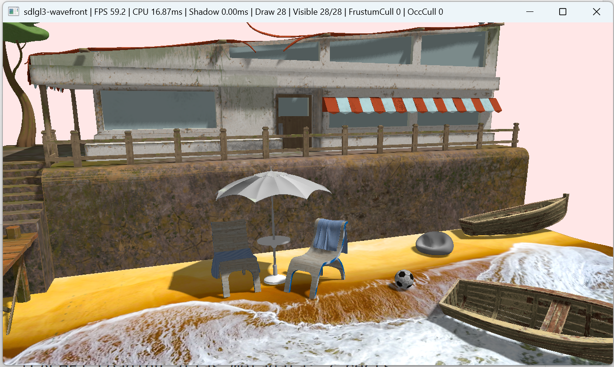

# sdlgl3-wavefront

A high-performance, production-grade 3D renderer starter focused on Wavefront OBJ loading, spatial scene culling, and dual-backend rendering (OpenGL 3.3+ baseline and modern Vulkan 1.2+). Built with SDL3, SDL3_image, GLM, and GLAD.


*Model credit: The model in the screenshot is "Holiday Beach Cartoon Scene" (also listed under names like "Beach Scene Cartoon Style" or "Beach House") [[1](https://www.cgtrader.com/3d-models/architectural/engineering/beach-house-9bcb27c9-5c45-41e1-963e-f7ab77eae1ea), [2](https://open3dmodel.com/3d-models/collections/19-restaurant-most-popular-2022)].*

---

## Key Highlights

- **Dual-Backend Rendering Architecture**: Unified backend interface (`IRenderBackend`) with runtime backend selection via `RenderBackendFactory` between a modern Vulkan 1.2+ graphics pipeline and an OpenGL 3.3+ Core Profile baseline.
- **Directional Shadow Mapping**: Millimeter-precision (~1.8mm/texel) directional shadows with fixed scene bounding sphere anchoring, hardware rasterizer depth bias, calibrated shader slope bias, and a 16-sample Poisson disk PCF filter.
- **Hierarchical Spatial Culling**: Multi-stage visibility pipeline featuring frustum culling (point, sphere, AABB, polygon) and hardware occlusion query culling.
- **Fast Binary Asset Cache**: Chunked v2 binary mesh cache format (`.binobj`) storing pre-computed vertex buffers, index buffers, and texture atlas metadata for instant startup times.
- **Agentic Interactive Visual Testing**: Continuous visual quality validation framework driving automated camera trajectories and performing computer vision analysis across 30s+ sessions to detect rendering regressions.
- **Zero-Dependency Headless Test Suite**: 8 comprehensive unit test suites validating math, camera kinematics, shadow projection stability, culling, and caching without requiring an active GPU display.

---

## Dual-Backend Architecture

The rendering system abstracts platform and graphics API specifics behind a clean interface:

```
                  +---------------------------+
                  |         Renderer          |
                  +---------------------------+
                                |
                                v
                  +---------------------------+
                  |   RenderBackendFactory    |
                  +---------------------------+
                                |
                +---------------+---------------+
                |                               |
                v                               v
    +-----------------------+       +-----------------------+
    |     OpenGLBackend     |       |     VulkanBackend     |
    |     (OpenGL 3.3+)     |       |     (Vulkan 1.2+)     |
    +-----------------------+       +-----------------------+
```

### `IRenderBackend` & `RenderBackendFactory`
All rendering commands are queued and dispatched via `IRenderBackend`. At startup, `RenderBackendFactory::createBackend` parses `renderer.backend` from `config/app.cfg` (or command line) and initializes the requested backend:

- **Vulkan 1.2+ (`VulkanBackend`)**:
  - Validates physical device features and memory types.
  - Custom swapchain management with triple buffering and fence synchronization for uniform buffers.
  - Hardware rasterizer depth bias stage (`VkPipelineRasterizationStateCreateInfo`) and dedicated depth attachments (`VK_FORMAT_D32_SFLOAT`).
  - SPIR-V compiled shaders (`shaders/vulkan.vert`, `shaders/vulkan.frag`, `shaders/vulkan_shadow_depth.vert`).
  - Seamless fallback to OpenGL 3.3+ if Vulkan initialization fails or no suitable GPU device is found.

- **OpenGL 3.3+ Baseline (`OpenGLBackend`)**:
  - Core Profile 3.3 pipeline with VAO, VBO, and EBO buffer state management.
  - Framebuffer Object (FBO) shadow depth maps with `GL_NEAREST` filtering.
  - GLSL shaders (`shaders/shadow_mapping.vs`, `shaders/shadow_mapping.frag`).
  - Fully compatible with legacy hardware and virtualized cloud environments.

---

## Directional Shadow Mapping

The shadow mapping system provides stable, high-definition directional sunlight shadows:

- **Millimeter Precision (~1.8mm/texel)**:
  Operating at $4096 \times 4096$ resolution over a tightly fitted scene bounding sphere volume, the orthographic projection achieves sub-centimeter sampling density (~1.8mm/texel) across the entire play area.
- **Scene Bounding Sphere Anchoring**:
  Unlike standard frustum-fitting methods that recalculate shadow bounds every frame as the camera rotates, `sdlgl3-wavefront` anchors the directional shadow volume to the scene's exact Welzl minimal bounding sphere. This guarantees sunlight matrix invariance under player camera movement and rotation, completely eliminating shadow edge shimmering, crawling, and swimming artifacts.
- **Dual-Stage Acne & Peter-Panning Prevention**:
  Self-shadowing artifacts (shadow acne) and detachment (Peter-Panning) are eliminated using a two-stage bias strategy:
  1. *Hardware Rasterizer Bias*: Configured via Vulkan rasterization state / OpenGL polygon offset.
  2. *Calibrated Shader Slope-Scaled Bias*: In Vulkan and GLSL fragment shaders, depth comparison uses a slope-scaled bias:
     $$\text{bias} = \max(0.0015 \times (1.0 - (\mathbf{N} \cdot \mathbf{L})), 0.00035)$$
- **16-Sample Poisson Disk PCF Filter**:
  Penumbra soft filtering uses a 16-sample Poisson disk distribution with randomized rotation per pixel. This produces soft, natural contact shadows with smooth penumbras without grid banding or pattern noise.

---

## Configuration Options

Configuration is decoupled into two clean INI-style configuration files:

### Application Configuration (`config/app.cfg`)

| Parameter | Default | Description |
|-----------|---------|-------------|
| `renderer.backend` | `vulkan` | Rendering backend selection: `vulkan`, `opengl`, or `auto` |
| `camera.speed` | `0.5` | Movement speed of the FPS camera |
| `mouse.speed` | `0.005` | Sensitivity of mouse look aiming |
| `window.width` | `1280` | Initial window width in pixels |
| `window.height` | `720` | Initial window height in pixels |
| `window.title` | `sdlgl3-wavefront` | Window caption text |
| `window.grab` | `true` | Restrict mouse cursor to the application window |
| `mouse.show` | `false` | Hide OS cursor during gameplay |
| `useBinObjCache` | `true` | Load and save pre-parsed `.binobj` binary cache files |

### Renderer Configuration (`config/renderer.cfg`)

| Parameter | Default | Description |
|-----------|---------|-------------|
| `shadow.enabled` | `true` | Enable or disable directional shadow mapping |
| `shadow.width` | `4096` | Width of the directional shadow map depth texture |
| `shadow.height` | `4096` | Height of the directional shadow map depth texture |
| `shadow.distance` | `15.0` | Shadow volume projection extent |
| `renderer.clearColor.r` | `1.0` | Background clear color Red channel $[0.0, 1.0]$ |
| `renderer.clearColor.g` | `0.8` | Background clear color Green channel $[0.0, 1.0]$ |
| `renderer.clearColor.b` | `0.8` | Background clear color Blue channel $[0.0, 1.0]$ |
| `renderer.clearColor.a` | `1.0` | Background clear color Alpha channel $[0.0, 1.0]$ |
| `renderer.culling.frustum` | `true` | Enable hierarchical view frustum culling |
| `renderer.culling.occlusion` | `false` | Enable hardware occlusion query culling |
| `renderer.textureAtlas.enabled` | `true` | Pack individual textures into dynamic atlas sheets |
| `renderer.textureAtlas.maxSize` | `4096` | Maximum texture atlas dimension in pixels |

---

## Agentic Interactive Visual Testing Skill

The repository includes an agentic visual verification skill located in [`.agents/skills/interactive-testing/`](.agents/skills/interactive-testing/):

```powershell
# Run a 35-second automated visual inspection session on Vulkan
python .agents/skills/interactive-testing/scripts/interactive_visual_test.py --backend vulkan --duration 35.0 --interval 2.5

# Run visual testing on OpenGL
python .agents/skills/interactive-testing/scripts/interactive_visual_test.py --backend opengl --duration 35.0 --interval 2.5
```

### Capabilities
- **Automated Navigation Trajectories**: Navigates the scene across 7 predefined camera phases (beach overview, contact shadow close-up, retaining wall inspection, boardwalk strafe, $360^\circ$ yaw rotation sweep, horizon tilt).
- **Time-Series Captures**: Captures full-resolution frames periodically (e.g. every 2.5s) over extended 30s+ sessions.
- **Defect Detection**: Analyzes luminance statistics, shadow presence ratio, acne/high-frequency banding, and temporal motion to provide an automated `PASS` / `WARN` / `FAIL` verdict with human-readable Markdown reports.

---

## Build and Run

### Prerequisites

- **CMake**: Version 3.20 or newer
- **C++ Compiler**: Modern C++17 compliant compiler (MSVC 2019+, GCC 10+, or Clang 11+)
- **Vulkan SDK** (optional, recommended): Required for compiling and running the Vulkan backend
- **SDL3 & SDL3_image**: Automatically cloned and built via CMake `FetchContent` if not found locally

### Build Instructions

Configure and compile the project using CMake:

```bash
# Configure
cmake -S . -B build

# Build (Release or Debug)
cmake --build build --config Debug
```

### Running the Application

Launch the executable:

```bash
# Windows
./build/Debug/sdlglapp.exe

# Linux / macOS
./build/sdlglapp
```

Controls:
- `W`, `A`, `S`, `D`: Camera translation (forward, left, backward, right)
- `Mouse Movement`: First-person camera look (pitch clamped to $[-89^\circ, 89^\circ]$)
- `Escape`: Release mouse grab and exit application

---

## Unit Testing

Run the comprehensive 8-suite unit test suite:

```bash
# Build the unit tests target
cmake --build build --config Debug --target unit_tests

# Execute all suites via CTest with detailed output
ctest --test-dir build -C Debug --output-on-failure
```

For more details on the unit test architecture and individual test suites, refer to [tests/README.md](tests/README.md).

---

## Documentation Links

- **Production Playbook**: [doc/Production_Playbook.md](doc/Production_Playbook.md) — Top-down architectural design, frame graph flow, and lifecycle guide.
- **Architecture Diagrams**: [doc/ARCHITECTURE_DIAGRAMS.md](doc/ARCHITECTURE_DIAGRAMS.md) — Visual system architecture and dataflow diagrams.
- **Technical Critical Review**: [TECHNICAL_CRITICAL_REVIEW.md](TECHNICAL_CRITICAL_REVIEW.md) — Rigorous multi-dimensional architecture and implementation review.
- **Interactive Testing Skill**: [.agents/skills/interactive-testing/SKILL.md](.agents/skills/interactive-testing/SKILL.md) — Automated visual testing framework.

---

## License

`sdlgl3-wavefront` is licensed under the BSD 2-Clause License.

Dependencies retain their respective licenses:
- **GLM**: MIT License
- **SDL3 & SDL3_image**: zlib License
- **GLAD**: Public Domain / MIT License
